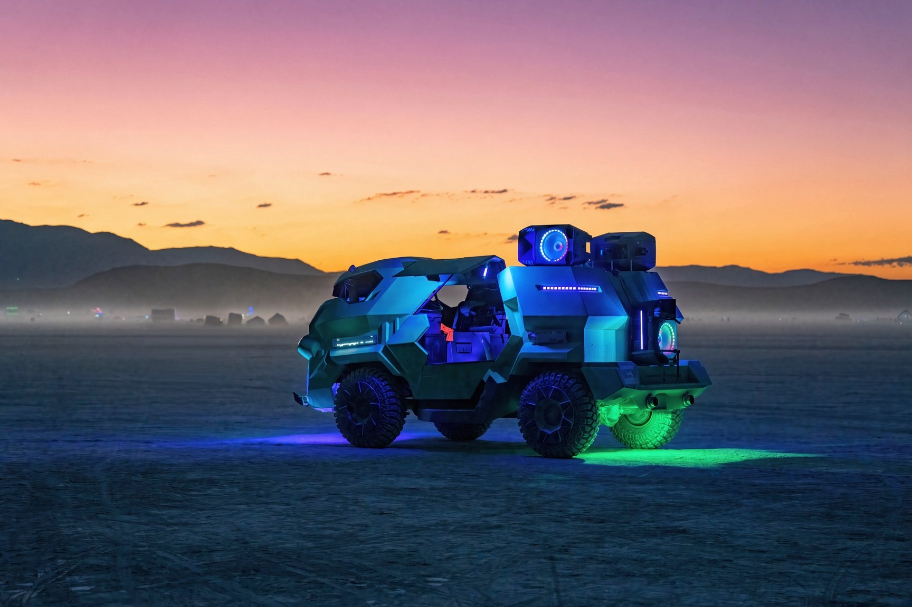
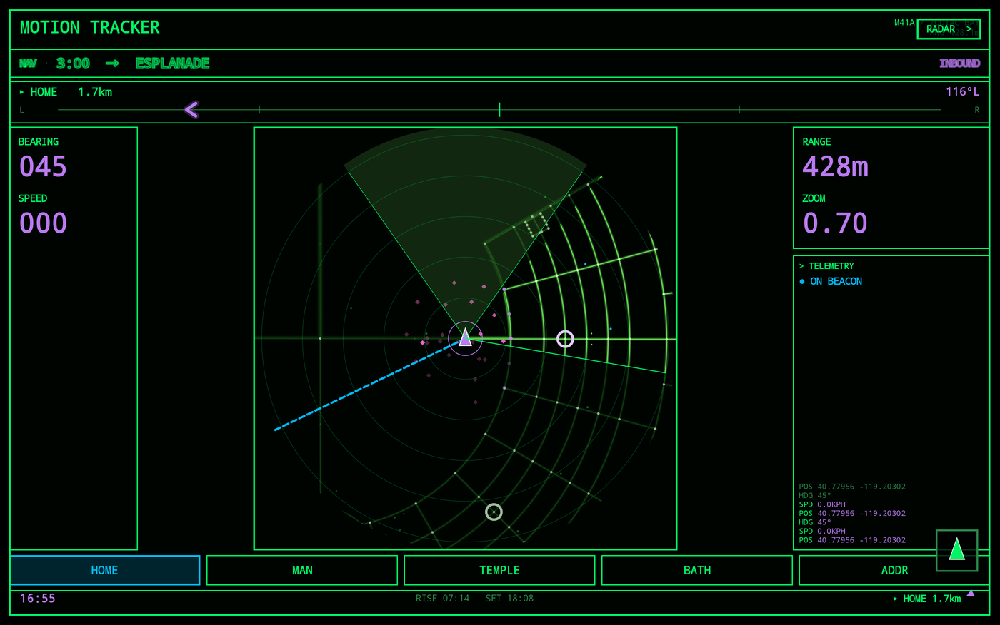
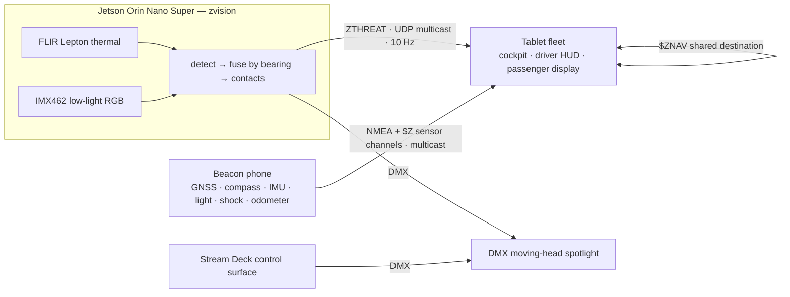
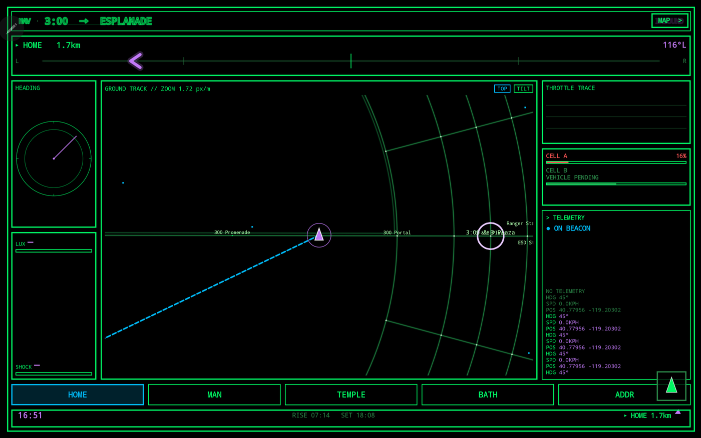
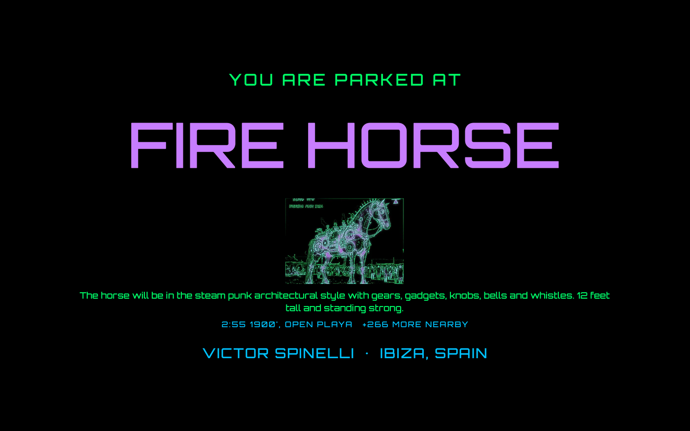
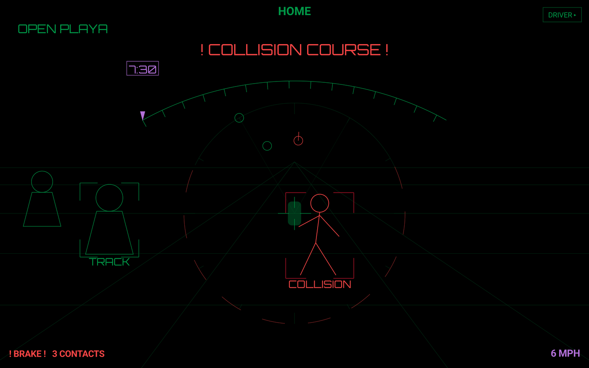
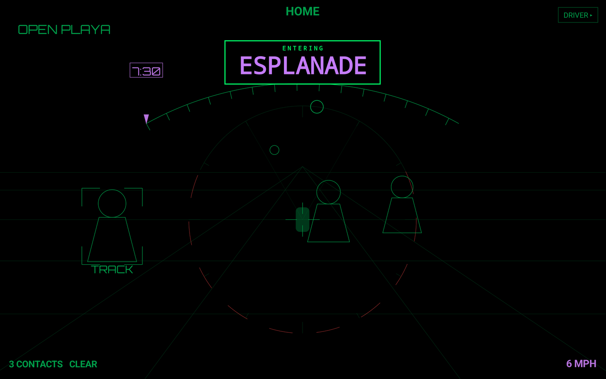
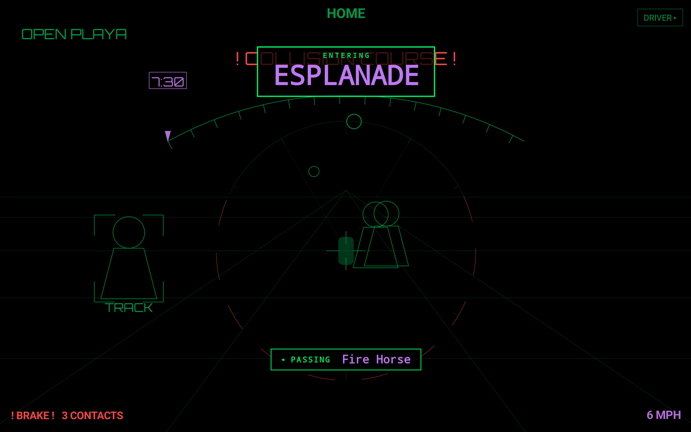

# Zodiac



*Software for Zodiac: a retro-futuristic, post-apocalyptic people carrier that
I run at Burning Man, with a cockpit straight out of 80s science
fiction.*

**ECLIPTIC is a distributed sensing, perception and actuation system for a moving
art car at Burning Man.** A GNSS and sensor beacon, a fleet of Android cockpit
tablets, and a Jetson Orin thermal and visible-light perception pipeline that
drives a tracking spotlight, all on the vehicle's own network with no cloud.
At Black Rock City in 2026 the beacon, the vehicle WiFi and the hero cockpit ran
on the vehicle, and a GPS bug was found and fixed on site. The full fleet was
tested together on the vehicle network before the event. The perception
pipeline is built and bench-validated, and its Jetson is installed in the
vehicle; mounting the cameras and running it there is next.



## Why it exists

Black Rock City is a temporary city of about 70,000 people, built on a dry lake
bed in northern Nevada and gone a few weeks later. Navigation there has an
unusual set of problems:

- **No reliable connectivity.** Cell and internet coverage can't be counted on,
  so everything realtime runs on the vehicle's own WiFi and every map, street
  and route is on-device.
- **Addresses are clock positions.** Streets are concentric lettered rings and
  radial "clock" streets around a centre point, and the city moves every year.
  Navigation isn't a normal street problem: from the open playa you first have
  to pick the right entrance into the city, then route through a grid unlike
  any ordinary city. Even typing in an address needs a Burning Man-specific
  input, so the cockpit has one.
- **Dust and heat.** Alkaline dust gets into everything, and days run past 40 °C.
- **Dark nights full of people, and very heavy vehicles.** Visibility from a
  big art car is difficult and limited, and pedestrians and bikes, many of
  them unlit, are all around it.

Zodiac's body began as a picture car, a city taxi from the 1995 film *Judge
Dredd*. Turning a film prop into a working transport was the real job: the power
system, the engine and every other system have been rebuilt or added to make it
a functional vehicle, rolling on huge wheels, with a 4,500 W stage audio system
on board. It's painted phosphorescent green, so it glows under black light, and
the film's markings are gone. The design language, for the vehicle and every screen, comes
from the 80s science fiction I grew up with: *Aliens*, *Star Trek*, *Blade
Runner*.

## What's in the box



| Part | Stack | What it does |
|---|---|---|
| [`:app`](app/), the cockpit | Kotlin, Jetpack Compose | Runs on 4 tablets. Three switchable cockpits (RADAR, MAP, DRIVER) over a live city map with street-following navigation, a passenger display, kiosk mode and OLED burn-in protection |
| [`:beacon`](beacon/), the sensor hub | Kotlin, headless Android | A rugged phone as the vehicle's shared sensor. Broadcasts GNSS, heading, light, shock and odometer as NMEA; for audio, only a level and a beat flag ever leave the phone |
| [`jetson/`](jetson/) zvision + zdeck | Python, OpenCV, Jetson Orin Nano Super | Thermal and visible perception, the DMX tracking light, and a six-key Stream Deck control panel |

The three parts share no code. They agree through documented wire formats
([`docs/PROTOCOLS.md`](docs/PROTOCOLS.md)), and the cross-language threat format
is checked against a measured golden corpus that both the Python and Kotlin
suites read.

## Field- and fleet-tested

On the playa in 2026 the beacon broadcast over the vehicle's WiFi and the hero
tablet navigated the city; that is where the parked-vehicle bug below was found
and fixed. Without the edge box and the other tablets the beacon added little, so
the hero was switched to its own GNSS and navigated on that. Everything else
here was exercised across the whole fleet (four tablets, the beacon, the edge
box) on the vehicle's network before the event:

- **GNSS failover that can't flap.** The tablets take position from the beacon
  over multicast and fall back to their own GNSS. The thresholds are
  deliberately asymmetric (drop after 3 s unhealthy, recover only after 10 s
  healthy), so a half-alive beacon can't make the source oscillate.
- **A shared destination across the fleet.** Set a destination on one of the
  two authority tablets and every screen adopts it over `$ZNAV`. Lamport
  `(seq, src)` ordering decides conflicts, and adopting never re-broadcasts,
  which is the whole no-echo guarantee.
- **Street-following routes.** Every in-city corner snaps to a real survey-data
  street vertex, so the drawn route stays on the drawn streets.
- **Honest absence.** A missing sensor sends nothing, never a made-up `0.0`.
  A dead vision feed reads `NO VISION`, never "all clear".
- **A bug found and fixed on site, at Black Rock City.** A GPS distance filter
  was starving a *parked* vehicle of its own fixes: 59 source flaps in a day, 0
  after the fix. Driving had masked it on every bench test. The full story is in
  [FIELD-NOTES.md](FIELD-NOTES.md).

<p>


</p>

## The perception pipeline (built and bench-validated)

**Why thermal.** At night the driver of a big vehicle sees very little around
it, and many of the people nearby are unlit. A thermal camera sees body heat
with no light at all, so it works where headlights and visible cameras don't
(LED headlights give off almost no infrared, so they don't help the low-light
cameras much either). The plan is a ring of cameras around the vehicle:
`zvision` fuses them into one full-circle list of the people nearby, the driver
HUD shows each one as a contact and warns of a collision course, the passenger
display counts the souls around the vehicle, and the tracking spotlight swings
onto the most urgent one.



*The DRIVER HUD, built for night driving. People ahead stand on a perspective
grid, a contact on a collision course is bracketed in red and raises `! BRAKE !`,
and the ring around the vehicle marker carries every contact in the full circle,
including those behind and to the sides. The arch at the top points to the
destination. Contacts here are synthetic (`zvision --source fake`).*

`zvision` reads a FLIR Lepton Ultra Wide thermal camera (160×120, 9 fps,
through a PureThermal USB board) and USB low-light visible cameras (Sony STARVIS
IMX462). It turns warm, moving bodies into vehicle-relative contacts with
bearing, size and a collision flag, and broadcasts them to the tablets at 10 Hz.
The DMX moving-head light swings to the most urgent one.

Every item below was measured on the bench and is pinned by tests:

- **Thermal you can actually use.** The board's 8-bit output was nearly flat (a
  standard deviation of 0.12 counts), so `zvision` reads raw 16-bit frames and
  normalises them itself. A per-frame median centre with a smoothed scale cut
  background swing on a static scene to 6.0 levels, against 10.9 for a naive
  stretch. It also crops the two Lepton telemetry rows that would otherwise show
  up as a permanent band of false motion.
- **Sensor quirks handled, not hidden.** A flat-field correction re-baselines
  every pixel at once, and a guard drops those frames instead of reporting a
  scene full of people.
- **Fusion by bearing.** Each camera is declared with its mount bearing, field of
  view and lens model (fisheye or rectilinear). Pixels are projected into vehicle
  bearings, so one person seen by two overlapping cameras becomes one contact. At
  startup the rig prints each camera's arc and its blind sectors.
- **Calibrated optics.** The thermal lens's "160°" turned out to be the diagonal,
  not the horizontal (±64°, not ±80°). Geometry settled it, and a measurement
  confirmed it: a true 40.4° target read 42.5°. The wrong reading would have
  mis-aimed edge bearings, and the spotlight, by up to 16°. A camera mount tilted
  more than 5° is refused rather than silently corrupting bearings.
- **Fails safe.** A camera that drops out costs only its own arc, which shows as
  blind, never as clear. A wedged USB camera is reopened without a restart; with
  no camera at all the process exits.
- **Perception to action.** The spotlight targets collision contacts first (a
  constant-bearing, closing-range rule), then the largest, with hysteresis so it
  doesn't twitch. BLACKOUT bypasses the normal output path, retries, and shows
  `DMX FAIL` if the kill didn't land.

<p>


</p>

*The DRIVER HUD shots are fed by `zvision --source fake` (synthetic contacts)
and a simulated GPS track, so their contacts are not real people. A street
name never covers the collision warning: it is dropped while the warning is up.*

**What's next, honestly:**
- Today's detector is classical computer vision (OpenCV MOG2 background
  subtraction on the CPU), not a trained model.
- Background subtraction assumes a still camera. On a *moving* vehicle the whole
  scene changes, so on-vehicle detection needs the trained-model path designed
  in [`jetson/DETECTOR.md`](jetson/DETECTOR.md): a YOLO-class detector exported
  to TensorRT on the Orin, fine-tuned on thermal and validated by range bucket.
  A `--record` mode already captures frames with weak labels to train it.
- The camera mount, its on-vehicle calibration, and range measurements are still
  to do.

## Real vs. not yet

| | Status |
|---|---|
| Hero cockpit (live map, navigation), beacon, vehicle WiFi | **Ran on the vehicle at Black Rock City 2026** |
| Whole fleet: four tablets, beacon sensor channels, shared destination, GNSS failover | **Tested together on the vehicle network** before the event |
| Perception pipeline, DMX tracking light, Stream Deck | **Built and bench-validated**; the Jetson is installed in the vehicle, the cameras are not yet mounted |
| Trained detector | **Designed, not built** (classical CV today) |
| Spotlight aim constants | **Uncalibrated placeholders** |
| Vehicle drive-system telemetry | **Not connected.** The transport layer is a fake; real data arrives only from the beacon and the vision box |
| Second battery tile (vehicle pack) | **A visibly labelled placeholder** until the Victron feed lands |

## What it demonstrates

- **Edge perception:** thermal and visible sensing, lens models, calibration by
  measurement
- **Sensor fusion:** multi-camera bearing fusion, GNSS failover without flapping,
  beacon sensor channels
- **Real-time distributed systems:** multicast protocols at ~10 Hz across a fleet
  of field devices, ordering and conflict resolution without a server
- **Safety-first design:** blind arcs instead of false all-clears, absent data
  never faked, a guaranteed light kill
- **Engineering discipline:** 1,932 unit tests (`:app` 1,210, `:beacon` 180,
  `jetson` 542, as of 2026-10-22), many mutation-checked, and CI with ktlint,
  detekt, Android Lint and both suites

## Run it

```bash
# Jetson perception with no hardware: synthetic contacts on the fleet bus
cd jetson
python3 -m unittest discover -s tests -t .      # standard library only
python3 -m zvision --source fake -v

# With cameras. Use stable by-path device names: /dev/videoN numbering
# can swap between boots and silently run one camera through another's optics.
python3 -m zvision --check \
  --camera thermal:/dev/v4l/by-path/<port>-video-index0:az=0:fov=160:lens=fisheye:fovref=d:name=thermal

# Android (JDK 17 + Android SDK)
./gradlew ktlintCheck detekt lintDebug testDebugUnitTest assembleDebug
```

Art and camp data come from the Burning Man API with your own key, fetched at
build time (see [`docs/BUILD.md`](docs/BUILD.md)). Without a key everything
still builds and runs; the art and camp markers stay hidden.

**Docs:** [technical overview](docs/OVERVIEW.md) ·
[architecture](ARCHITECTURE.md) · [wire protocols](docs/PROTOCOLS.md) ·
[build & deploy](docs/BUILD.md) · [field notes](FIELD-NOTES.md) ·
[Jetson](jetson/README.md) · [hardware](jetson/HARDWARE.md) ·
[detector roadmap](jetson/DETECTOR.md)

## What I built

I built Zodiac itself, turning a film prop into a working mutant vehicle, and I
conceived and built ECLIPTIC end to end: what it does, how the parts work
together, the hardware and components it takes to realise it, and the taste
behind every screen. I designed the system and its four wire protocols,
specified and assembled the edge hardware (Jetson, thermal and visible cameras,
DMX light, control deck), and wrote the software with AI coding agents working
under my direction and review.
[`CLAUDE.md`](CLAUDE.md) is the working guide those agents follow.

## License

Apache 2.0. Third-party map data is used under its own terms; see
[`NOTICE`](NOTICE).

This project is not affiliated with, endorsed or verified by Burning Man Project.

Rob Williams · [github.com/pureagave](https://github.com/pureagave)
